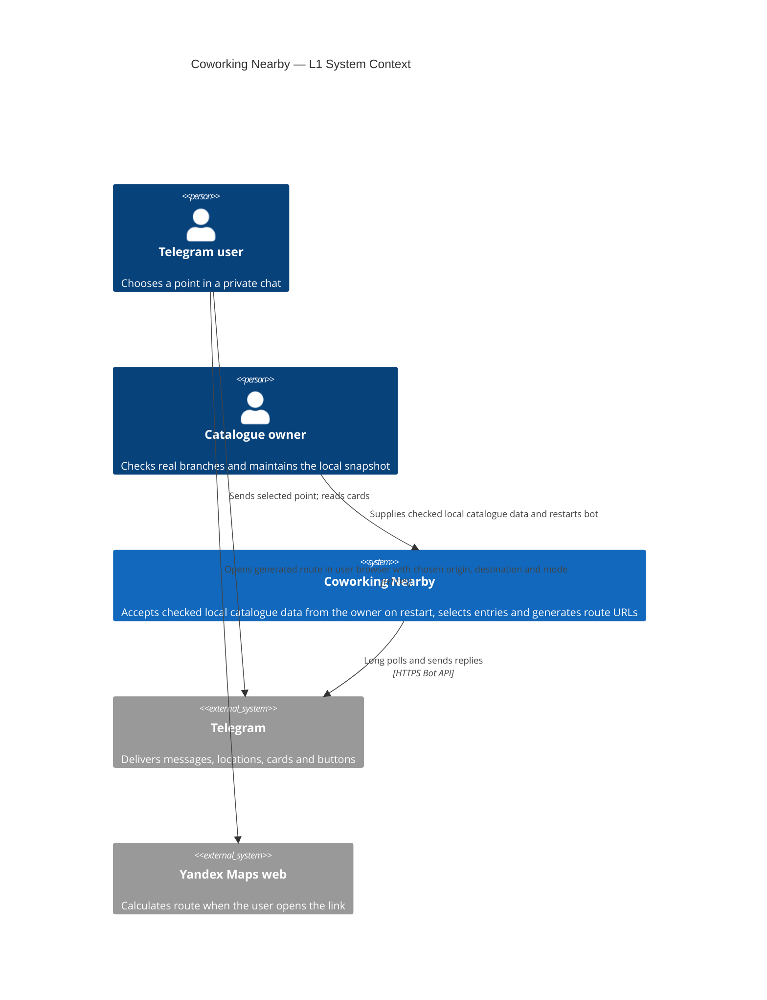
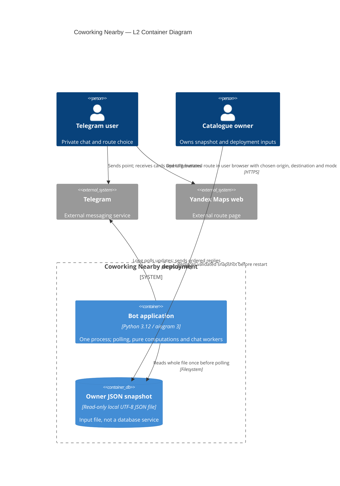

---
id: ADR-001
title: "Coworking Nearby — single polling application and strict local snapshot"
status: draft
depth: standard
created: 2026-10-18
updated: 2026-10-18
valid_until: 2027-01-16
generator_identity: creator/architecture-adr-20261018-01
generator_role: forgeplan_creator
links:
  - target: PRD-001
    relation: based_on
  - target: SPEC-001
    relation: based_on
---

# ADR-001: Coworking Nearby — single polling application and strict local snapshot

## Progress

Architecture draft only. Zero implementation units completed; every implementation path and verification below is FUTURE work. No application code, tests, live calls, deployment or runtime verification were executed. Pipeline observed phase=rfc, depth=standard, dev_unlocked=false; it is not changed. This draft does not unlock Build.

## Context

The approved Standard BMAD + Spec Kit cycle requires a small Russian Telegram bot selecting places from an owner-controlled catalogue. Active parents read through role MCP: PRD-001 updated_at=2026-10-18T20:51:11.875851+00:00 and SPEC-001 updated_at=2026-10-18T20:51:12.611918+00:00. Active Brief NOTE-001 updated_at=2026-10-18T18:29:58.718062+00:00 provides provenance. Artifact metadata is authoritative for active status; historical draft prose in these active bodies is not a new lifecycle decision.

Original source read: /Users/mxmknn/.codex/attachments/38a9bdff-7b37-4c55-8851-d338dfe1c340/Pasted text.txt, version 1.0 dated 2026-10-18; raw-byte SHA256 cbde92035f9e674f3a673f380c0f108b4c60f905e84eac8d48dbe70514e6f040. Full source appendix already lives in NOTE-001 and PRD-001 and is referenced, not copied here. Its external-document verification claims are source provenance, not verification performed for this ADR.

AGENTS.md and .codex/agents/forgeplan-creator.toml were read first; repository context includes role proxy, configuration and pipeline state. No existing application or dependency manifest was found in the inspected repository listing. Read-only CLI health reported 12 active artifacts, advisory phase mismatches, and project healthy; that advisory does not authorize Build. Exactly one built-in ADR template was instantiated via role MCP new(kind=adr), and its get was inspected before replacing this body's template content. Existing artifacts and pipeline remain outside mutation scope.

Drivers: PRD FR-01–08, AC-01–18, AX-01–12; strict SPEC C01–C08; one process, no persistent search history, reproducible offline core, and honest partial-delivery behavior. Demand, catalogue scale, latency and availability targets are unmeasured.

## Hypotheses

### Hypothesis H1 — do-nothing or scope reduction

Keep only the specification or return names/distances without source labels, descriptions and three route buttons. This minimizes implementation but leaves FR-03/07/08 and AC-07/10/11 unmet. Rejected for this approved scope; economic benefit of implementation is not thereby proved.

### Hypothesis H2 — one modular application

One Python 3.12 process with aiogram 3 long polling, one immutable local snapshot and pure domain functions can satisfy the stated MVP without distributed state. Selected on requirements fit, deployment simplicity and privacy boundaries. It remains falsifiable by future acceptance checks, especially FIFO, error handling and schema extremes; no performance claim is made.

### Hypothesis H3 — multiple services and databases

Separate selection/rendering/catalogue services plus SQL/Redis could support independent scaling or durable queues. Neither capability is required here; extra network failure modes, schema coordination, migrations and retained location data increase cost and risk. Rejected for MVP relative to H2. Measured overload or an approved durable-work requirement would reopen the decision.

### Hypothesis H4 — external API enrichment

Live geocoding, ratings or route-time ranking could provide new capabilities but introduces contracts, credentials, availability and data-use obligations, and changes FR-06/08 semantics. Rejected for MVP relative to H2. No bot-to-Yandex API, page fetching, scraping, LLM, automatic coordinate extraction or hidden API dependency is introduced.

Deduction: H1 drops accepted behavior; H3 adds unneeded infrastructure; H4 changes scope; H2 preserves the approved constraints. Induction is limited to document reasoning, not independent Evidence or measured user value.

## Decision

**Selected**: One modular Python 3.12 application, aiogram 3 long polling, read-only owner JSON, request-local computations and no persistent user state.

**Why Selected**: One deployment unit and one catalogue acceptance boundary match the active requirements. Pure functions make offline verification possible without Telegram or Yandex access. Telegram-specific types, sending, scheduling and exceptions stay at the edge.

### Module map and dependency direction

All paths below are future paths under a flat coworking_nearby/ package. No modules are separate C4 containers.

| Module | Owns / proposed contract | Direct internal dependencies |
|---|---|---|
| models.py | Immutable Coworking, Origin(latitude, longitude), SearchResult(coworking, distance_m), RouteMode, framework-neutral Card/keyboard values and CatalogDiagnostic types | none |
| config.py | Immutable Settings; read/validate BOT_TOKEN, CATALOG_PATH default data/coworkings.json, RESULTS_LIMIT default 3 integer 1..5, LOG_LEVEL default INFO; secret-safe representation | none |
| catalog.py | load_catalog(path) returns a complete ordered immutable tuple of normalized Coworking or raises structured CatalogDiagnostic; shared byte decoder/validator; offline entry main | models |
| geo.py | validate_origin and find_nearest(origin, snapshot, limit); Haversine and exact deterministic ranking | models |
| routes.py | build_yandex_route_url(origin, destination, mode) pure URL construction, no networking | models |
| render.py | Pure distance formatting, Russian instruction/help/empty/error text, render_card(result, position, origin) -> Card; escaped text and plain button descriptors | models, routes |
| telegram_app.py | aiogram adaptation, accepted message dispatch, chat FIFO scheduling, bounded send policy, exception/log boundary, constructing aiogram markup from Card | models, geo, render; Settings passed by startup |
| __main__.py | Small composition root: normal config, atomic catalogue load, application wiring, polling and graceful shutdown | config, catalog, telegram_app |
| __init__.py | Package marker without import-time I/O or side effects | none |

Dependency arrows follow this table only; domain modules never import aiogram, config, startup or the adapter. render uses routes, never geo: it receives an already computed distance. catalogue accepts a path argument, never reads environment itself. telegram_app receives settings and snapshot; it does not reload files or mutate models. catalog's offline entry uses standard-library argument parsing without importing config/aiogram or requiring BOT_TOKEN. Proposed invocation: python -m coworking_nearby.catalog [path], default data/coworkings.json; exit 0 for success including [], exit 1 for catalogue/configured-file failure, exit 2 for invalid command usage. Normal bot start: python -m coworking_nearby. These are future interfaces, not executed commands.

### Ownership, data lifecycle and flow

The owner owns real places, semantic branch/address/city+house/coordinates/link correspondence, and source/date of stored ratings. The app owns syntactic acceptance and immutable snapshot use. At startup it validates the entire catalogue, retains active and inactive normalized entries in file order, then begins polling. A changed file is invisible until restart. No hot reload, in-process editor or demo fallback exists.

Normal flow: Telegram delivers an initial private message -> adapter extracts location or venue.location -> validate finite numeric origin within bounds -> request-local immutable Origin -> geo selects active records -> render produces introduction and ordered Cards with routes derived from that same Origin -> adapter sends sequentially, replying to that location message id. Coordinates, Cards, send cursor and opaque request id live only through processing/retry and are released on success/error/cancellation. A waiting update necessarily retains its payload transiently until processed; no disk queue, retained completed payload, search cache or profile is allowed.

For /start and /help use active PRD texts with dynamic limit and ordinary request_location keyboard. Manual location before /start works. Group messages receive a private-chat direction and never search; edited_message is ignored for search. Initial live location produces one search. Origin denotes the chosen point, not proof of physical presence. Empty active results use the exact PRD empty text. All response destination and reply identifiers belong to the same request envelope; old messages/URLs are never rewritten.

### Concurrency and delivery boundary

Use one event loop and one ordered ingress scheduler in telegram_app. Enqueue accepted messages synchronously in polling update order into a FIFO per chat before launching/awakening that chat's sole worker; a lock around independently spawned handlers alone is insufficient to define ingress order. Each worker processes the complete request/send sequence before the next message in that chat. Different chat workers run concurrently. Only chat scheduling metadata is shared mutable state; never a shared latest Origin. Worker/queue entries are reference-counted or otherwise race-safely removed when idle; cleanup must not orphan a newly enqueued update. No durable queue or restart replay guarantee is claimed.

For an explicit Telegram 429 refusal, allow at most one retry of that individual send (two attempts total), waiting at least retry_after; cancellation interrupts the wait. A second 429 ends this request's remaining delivery. A blocked/forbidden recipient ends its delivery immediately. Other definite send failures terminate remaining delivery for that request without crashing other workers. An ambiguous timeout/transport failure is not automatically retried because Telegram may already have accepted it. Keep an in-memory ordered send cursor; confirmed introduction/cards are never resent and the whole set is never blindly restarted. Partial delivery is allowed on failure and is not presented as complete success. Every send, including help/fallback, uses this same boundary; failure-notification sending must not recurse. Polling reconnect is independent of card-send retries and never manually replays a completed search. Exactly-once delivery across process death is not promised.

### Selection, routes and rendering decisions

geo validates origin without boolean/string coercion, filters active only, applies Haversine R=6371000 metres in radians with clamp [0,1], sorts unrounded distance_m ascending then normalized id by Unicode code-point ascending (case-sensitive), and takes min(limit, count). No radius, city, rating reorder or travel-time calculation. Coincident, negative, zero and distant points remain valid.

Choose subkilometre display as nearest whole metre, nonnegative half-up floor(distance_m+0.5); test the <1000 threshold against unrounded distance before formatting. Thus 999.6m may display approximately 1000m; exactly 1000m displays 1,0 km. At/above 1000m use decimal half-up one decimal kilometre from the unrounded distance; Russian decimal comma is display-only. Always retain the PRD approximate/straight-line wording.

routes builds https://yandex.ru/maps/ query with standard urlencode: rtext=origin_lat,origin_lon~destination_lat,destination_lon and rtt=pd/mt/auto. Format coordinate values with decimal dot and at most six fractional digits, trim insignificant zeros and normalize rounded negative zero to 0. Endpoint order is latitude,longitude and origin before destination. Rounding is only for URL display, never ranking. No browser geolocation is needed. Organisation URL is a separate optional button preserved after SPEC trim.

render preserves PRD card order, exact labels/fallbacks and button layout (walk/transit first row, car second, optional organisation third). Escape all catalogue text for Telegram HTML exactly once at the rendering boundary, including quotes; do not escape URL values as text or alter validated organisation URLs. Use framework-neutral keyboard descriptors; adapter conversion must not infer origin from globals. Show catalog ratings as list assessments, yandex ratings as saved values with date DD.MM.YYYY, no rating line if absent, no invented content. Keep each valid card in one text message; URLs are keyboard data, not appended to its text.

### C4 L1 — System Context

L1 shows the Coworking Nearby software system boundary and external software systems; local file data is detailed only in L2. The browser is a client/channel on the user’s device.

### C4 L2 — Container Diagram

Exactly one executable application/container, app, is deployed. ContainerDb(json) represents the read-only local UTF-8 JSON file/data store, not a database process or service; Python modules are internal components. The browser is a client/channel on the user's device through which the user opens the generated HTTPS route with the chosen origin, destination and mode. No diagram edge connects bot/app to Yandex and no Yandex API is called by bot/app. No new HTTP listener/webhook is part of deployment.

## Alternatives Considered

| Option | Verdict | Why |
|---|---|---|
| H1 do nothing / reduce card scope | Rejected | Fails approved product behavior and planning handoff |
| H2 flat modular single process + local snapshot | Chosen | Matches required capability and keeps data/side-effect boundaries explicit |
| H3 microservices + SQL/Redis | Rejected | No independently scaled or durable data requirement; increases coordination/retention |
| H4 external enrichment / time ranking | Rejected | Different approved scope and external contracts; not prerequisite for selection |
| One global sequential handler | Rejected | Serializes unrelated chats and couples them to retry waits |
| Unordered task per update / global last origin | Rejected | Cannot establish required FIFO or safe origin isolation |
| Skip invalid/inactive malformed records | Rejected | Weakens active SPEC atomic validation |

## Consequences

### Positive

One release unit, no database migrations or external enrichment credentials; offline deterministic domain verification; explicit privacy and Telegram error boundary. Owner catalogue remains the sole source of place content.

### Negative (trade-offs)

Restart is required for catalogue updates. A single invalid entry blocks the entire new startup. Single-process crash interrupts pending deliveries and transient queue contents. Search is O(n log n) sorting and in-memory; supported catalogue size and load limits require measurement. Long retry_after blocks that chat's next request, while other chats progress.

### Risks

Queue growth under overload is unmeasured; RFC must set an explicit resource/admission policy without silent loss or privacy retention changes. Telegram HTML text limits and URL-button transport limits are distinct: SPEC intentionally imposes no extra organisation-URL length cap. Do not reject a SPEC-valid catalogue, trim links/text, omit required buttons or claim every possible URL is accepted by Telegram. Rendering keeps URLs outside text; the RFC must verify maximum text after Telegram entity parsing and explicitly characterize platform URL limits. If unrestricted valid URLs cannot be delivered, record a requirement conflict for owner resolution before claiming AC-15/AX-05 complete; the send boundary contains the failure. This ADR does not silently solve that conflict with a new catalogue limit.

## Invariants

1. All active PRD behavior and SPEC C01–C08 apply together; this ADR never relaxes or reopens SPEC's adopted rules merely because historical body text calls them proposals.
2. Strict UTF-8, no BOM/unpaired surrogates/duplicate members/nonstandard NaN/Infinity; root array, object entries, closed 13-field model. No coercion, unknown fields, partial acceptance or demo fallback; inactive malformed records also fail before polling.
3. Preserve SPEC's exact trim code-point set (U+0009–000D, U+0020, U+0085, U+00A0, U+1680, U+2000–200A, U+2028–2029, U+202F, U+205F, U+3000), code-point length, no case folding/Unicode normalization/internal whitespace rewriting; normalized ids unique case-sensitively.
4. Required strings id/name/address have 1..64/150/250 code points; finite numeric coordinates latitude [-90,90], longitude [-180,180], neither bool/null/string. Same coordinates with distinct ids are permitted. active is strict boolean with omitted=true; null/blank is invalid.
5. Nullable optional strings omitted/null/trim-blank become absent. short_review<=200, description<=500, rating_text<=50. rating_source omitted/blank defaults catalog, null invalid, exact catalog/yandex enum. Present fields validate regardless of use. Dates use exact ASCII Gregorian YYYY-MM-DD, year 0001..9999, no freshness/future restriction. A present yandex rating requires valid present organisation URL and check date; absent rating invents nothing.
6. Organisation URL follows every C06 rule: absolute HTTPS, exact ASCII case-insensitive yandex.ru/yandex.com host, no wildcard/www/trailing dot/encoded host/IDN/IP/userinfo; only no port or literal :443. Raw case-sensitive path /maps or /maps/ prefix, no encoded slash/backslash or literal/encoded dot segments. Preserve accepted URL after trim. No internal defined whitespace, C0/DEL, backslash, malformed percent escapes, encoded C0/DEL/backslash. Query/fragment are data, not a coordinate source. No fetch/redirect/shortlink resolution and no extra URL length limit. C06 remains normative for detailed parsing edge cases.
7. Diagnostic classes and context exactly follow SPEC C03: path, class, field, normalized id when available otherwise zero-based index; file/encoding/JSON/root have specified pseudo-fields and N/A record. Unknown field names are identified. No full file/raw offending value dump; shared startup/offline validation has identical acceptance, normalization and diagnostic class. First-error order is not a public oracle.
8. Snapshot is immutable and includes inactive entries; selection alone filters active. Shared mutable latest coordinates/history do not exist. Every URL and reply uses its request's own origin and identifiers.
9. No persistent user/search data, no bot Yandex requests, no DB/Redis/HTTP server/LLM. Source and tests remain future work until active RFC readiness and lawful unlock-build.

## Privacy, threat and error boundaries

Telegram receives the chosen point and reply URLs as part of normal messaging; clicking a route exposes explicit endpoints to Yandex/browser history. The app's no-history promise does not erase Telegram or browser history. Do not claim physical-location verification or downstream deletion.

Treat update coordinates and owner catalogue content as untrusted typed input. Strict catalogue URL policy prevents arbitrary destinations for organisation buttons; route host is a constant. HTML escaping prevents catalogue markup injection. Never fetch catalogue URLs, so no bot-side SSRF path is introduced. The owner remains responsible for semantic place correctness; syntactic success is not proof of a real branch.

Configuration/token failures stop normal startup before polling; missing file gives actionable CATALOG_PATH/path/permissions guidance. Offline catalogue checking needs no token. Do not instantiate Telegram client before configuration and full catalogue success. Adapter catches Telegram errors per request; unexpected domain/invariant exceptions stop that request, emit only a sanitized code/stage/opaque request id, release local state, and leave other workers running. Startup invariant failure exits rather than serving a partial catalogue.

Use allowlisted structured logging fields; never log raw updates, chat/user identifiers, token, exact origin, full route URL, full Card or raw exception/traceback payload that might contain them. Opaque request ids are random and not derived from chat or coordinates. Catalogue diagnostics may contain required path/field/id-or-index, but not catalogue values or secrets. Apply this boundary to third-party HTTP/aiogram logging and errors, including DEBUG; LOG_LEVEL does not authorize sensitive output. Secrets come from deployment environment and have redacted representations; no .env/token embedded in the image. Disable sensitive HTTP request dumps and crash-local-variable capture. These are design obligations awaiting independent log-capture verification, not established runtime properties.

## Evidence Requirements

All checks are FUTURE work, with isolated synthetic fixtures and a fake send adapter. Creator reasoning is not independent certification.

| Claim | Required future observation | Trace |
|---|---|---|
| Strict catalogue | Full SPEC T01–T24 acceptance/rejection/normalization and identical offline/startup behavior; invalid last/inactive entry blocks polling | C01–C08; AC-14, AX-09/12 |
| Deterministic core | Known order, exact ties, same coordinates, poles/zeros/negative/distant points, 999/1000 threshold and limits 1..5 | AC-03/05/06/12/13, AX-10 |
| Honest links | Parse query of all modes for two origins; explicit lat/lon order, swap regression, decimal precision and no fetch | AC-04/07/08, AX-11 |
| Correct UI | Exact Russian texts/fallbacks/source/date/card order, HTML special characters, max valid text and URL-button boundary characterization | AC-01/02/09/10/11/15, AX-01–05 |
| Isolation/delivery/privacy | Deterministic overlapping two chats/two origins; FIFO ingress, worker cleanup race, 429 bounded retry, blocked, ambiguous timeout, partial send, cancellation; capture all logs including library failures | AC-16–18, AX-06–08 |
| Lifecycle | Snapshot unchanged until restart, new invalid file stops new startup, standalone no token/network, graceful cleanup | AX-09/11/12 |

Before activation: independent artifact review and independent ADI Evidence on the exact frozen revision, applicable S10–S13 coverage, then fresh Guardian PASS. None are created or asserted here. No runtime/code/test PASS is claimed.

## Valid Until

**Date**: 2027-01-16, proposed body review date (90 days after 2026-10-18). Metadata valid_until is not set by the role update API; body date is a review intention, not a claimed metadata TTL.

**Rationale**: Modest review interval for an unimplemented external-client-dependent design, not a forecast of compatibility.

**Refresh Triggers**: changes to active PRD/SPEC, measured overload, need for durable queues/multiple replicas, catalogue editing without restart, actual Telegram delivery constraints, dependency/API incompatibility, privacy incident, or approved enrichment/time-ranking work.

## Pre-conditions (чеклист ДО реализации)

- [ ] Independent review/ADI and Guardian workflow complete for relevant artifacts; this ADR remains draft until a separately authorized gate.
- [ ] Active RFC passes readiness and unlock-build succeeds through the orchestrator; current dev_unlocked=false is preserved.
- [ ] RFC pins compatible exact Python image/aiogram/dependency versions without latest, closes queue resources/shutdown timing, text/button constraints and compatibility evidence.
- [ ] RFC preserves all C01–C08 rules and traces PRD AC/AX to implementation and future verification.

## Post-conditions (Definition of Done)

- [ ] Future implementation observes dependency and data ownership boundaries.
- [ ] Future independent offline verification records all applicable AC/AX and SPEC scenarios, including fault injection and logging.
- [ ] Owner validates real catalogue/token; real catalogue remains [] before records and synthetic example stays separate.
- [ ] After owner inputs, manual two-origin/all-three-mode route verification records actual results or explicitly unperformed status.

## Admissibility

No additional services, databases, HTTP listener, webhook deployment, automatic enrichment, telemetry retaining locations, schema weakening or fake Evidence under this decision. No runtime code/tests were run for this draft. Paid resources/publication require a separate instruction. A new architecture request must go through the planning workflow rather than being inferred from missing inputs.

## Rollback Plan

### Deployment boundary

Future deployment is one bot service/image, one Python process and one read-only catalogue mount. BOT_TOKEN is supplied securely at runtime; RESULTS_LIMIT/CATALOG_PATH/LOG_LEVEL validated on start. No exposed HTTP port or database volume. Dockerfile/compose, exact dependency pins and operational instructions are future PRD deliverables owned by RFC/Build. One polling instance per bot token; no rolling overlap or simultaneous replicas.

Future release: validate candidate catalogue offline, prepare compatible image+catalogue pair, stop old polling instance, start candidate, validate before polling, observe sanitized startup/delivery outcomes. Graceful shutdown stops ingress, cancels remaining request-local tasks after an RFC-defined finite drain deadline, closes Bot HTTP session and removes queues/state. Restart is not a durable delivery mechanism. No queued payloads are dumped.

**Triggers**: candidate startup validation failure, incorrect links/order, privacy leakage, repeated application delivery defects or incompatible dependency release.

**Steps**:
1. Stop candidate and its polling; if privacy incident, first contain/redact logging and rotate token only if actually exposed.
2. Restore last known compatible pinned image and owner-approved catalogue snapshot together; avoid introducing catalogue fields unsupported by that image.
3. Revalidate snapshot and configuration before restarting the single polling instance. If no safe pair exists, remain stopped and inform operator through existing operations, not by sending messages in this task.
4. Do not replay whole interrupted result sets; user can submit a fresh point. Recheck failure with future independent verification before resuming rollout.

**Blast Radius**: one bot's availability and in-flight deliveries. No DB migration to reverse; already delivered Telegram URLs and downstream history cannot be recalled by local rollback. Catalogue content belongs to owner; application rollback must not invent replacement places.

## Weakest Link

There is no independent evidence for this new draft yet; no reliability score is computed. Requirements fit does not establish implementation correctness, useful real data or demand. Weakest technical uncertainties are actual Telegram delivery of unrestricted valid organisation URLs, FIFO/resource behavior under load, and sensitive library-error logging. These require future RFC closure and independent observation.

## Affected Files

All are FUTURE intended application paths; no files have been created or edited. Baseline hashes are N/A because these are proposed new modules, not existing implementations.

| File | Baseline Hash | Future purpose |
|---|---|---|
| coworking_nearby/__init__.py | N/A — proposed new | Side-effect-free package marker |
| coworking_nearby/__main__.py | N/A — proposed new | Small composition/startup module |
| coworking_nearby/config.py | N/A — proposed new | Environment config and safe settings |
| coworking_nearby/catalog.py | N/A — proposed new | Shared strict loader and offline command |
| coworking_nearby/models.py | N/A — proposed new | Immutable framework-neutral values |
| coworking_nearby/geo.py | N/A — proposed new | Origin validation and nearest selection |
| coworking_nearby/routes.py | N/A — proposed new | Pure HTTPS link construction |
| coworking_nearby/render.py | N/A — proposed new | Pure Russian HTML and button descriptions |
| coworking_nearby/telegram_app.py | N/A — proposed new | Telegram adapter/scheduler/send/privacy boundary |

Tests, synthetic fixtures, real empty data/coworkings.json, pinned manifest, Dockerfile, compose.yaml, .env.example, .gitignore and Russian README are FUTURE PRD deliverables, not edits in this task.

## AI Guidance

Use this as a proposed architecture input to an independent RFC creator, not Build authorization. Preserve active PRD/SPEC exactly; raise conflicts explicitly, especially URL/button constraints. Never treat generator self-reasoning or structural validation as independent Evidence. Do not alter existing artifacts or pipeline from this role.

## Implementation Plan

### Phase 0: Foundation — future after readiness

- [ ] RFC closes exact pins, resource/admission policy, finite shutdown drain and external payload constraints.
- [ ] Build later creates flat package, config and shared catalogue checker preserving all SPEC scenarios.

### Phase 1: Core — future after readiness

- [ ] Build later implements pure geo/routes/render, then adapter FIFO/error/privacy boundaries.
- [ ] Independent verifier later observes offline acceptance and owner-dependent live checks; rollout follows its authorized gate.

## Implementation Log

No implementation activity. No code, tests, source/docs, pipeline, guard or sandbox changes. Only this new ADR and its based_on links are authorized mutations.

## Related Artifacts

| Artifact | Type | Relation |
|---|---|---|
| PRD-001 revision 2026-10-18T20:51:11.875851+00:00 | active PRD | ADR-001 based_on PRD-001 |
| SPEC-001 revision 2026-10-18T20:51:12.611918+00:00 | active SPEC | ADR-001 based_on SPEC-001 |

No RFC or Evidence is created. Links are explicit based_on without autoactivation.

## Standard methodology S10–S13

| Layer | Draft coverage | Remaining independent obligation |
|---|---|---|
| S10 FPF ADI | H1–H4, deduction, bounded inference; required reason attempt on this ID with save=false | Independent ADI Evidence; creator reasoning is not a substitute |
| S11 BMAD | PRD FR/AC/AX drivers, alternatives, risks and required future observations | Independent artifact review on frozen revision |
| S12 Spec Kit / contract alignment | Normative SPEC C01–C08 preserved, module/flow/error/ownership invariants and future scenario mapping | RFC implementation contracts and subsequent independent proof |
| S13 ForgePlan | Real built-in template, one new Standard ADR, own-ID update, parent links, deterministic validation and final get | Fresh Guardian PASS and all applicable coverage before any later activation |

All S10–S13 apply; draft coverage is not a claim of passing activation gates.

## Unresolved assumptions and limitations

Owner still supplies token and validates real branch data; demand/scale are unmeasured. Exact dependency pins, resource/admission bounds, shutdown drain deadline and Telegram text/URL-button compatibility are RFC closures before Build. No schema URL cap may be invented to close them. External pages/docs were not reverified here. No existing runtime is proved by this artifact. The catalogue SPEC's active metadata governs despite its historical proposal wording.

Reason invocation outcome and final deterministic validation are recorded after the actual tool calls; neither self-review nor validation grants activation.

Actual role-scoped forgeplan_reason(id=ADR-001, save=false) returned isError=true: "MCP tool call requires approval, but approval policy is never". Runtime approval policy blocked the call; no ADI tool reasoning output was obtained, no provider diagnosis is inferred, and no bypass was attempted. H1–H4 and the decision above are the creator's own reasoning only. Independent ADI remains pending.

Initial deterministic validation passed all MUST rules with two SHOULD findings (Related Artifacts/body-frontmatter link consistency and exact Rollback Plan heading). This own-ID revision adds matching body frontmatter parent links, removes the incidental Brief table row, and uses the built-in Rollback Plan heading; final validation is performed after this update. The actual graph links remain the two permitted based_on parents.

Final-check note: deterministic validation after the heading/link-body correction returned passed=true, 0 errors and 1 SHOULD body-links-drift warning. Both based_on link calls succeeded and the markdown projection's outer frontmatter contains PRD-001 and SPEC-001; the validator still reports link drift. This tooling consistency warning is retained transparently rather than removing substantive parent references or modifying existing artifacts. It is not an activation PASS or an independent review.

