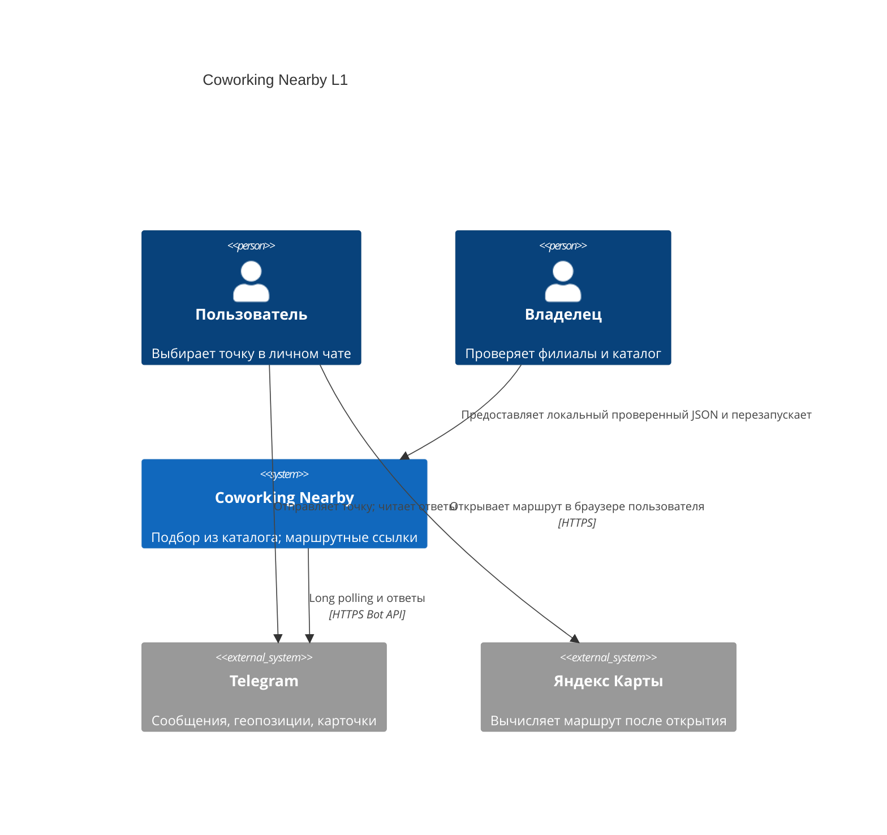
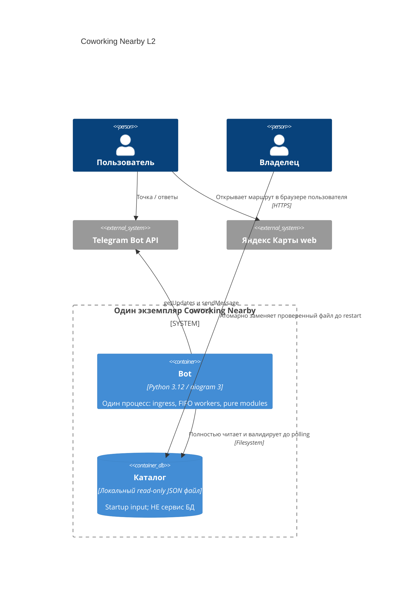

---
id: RFC-001
title: "Coworking Nearby — Standard implementation and offline verification"
status: draft
depth: standard
methodology: bmad
created: 2026-10-19
updated: 2026-10-19
generator_identity: creator/rfc-coworking-20261018-01
generator_role: creator
maintenance_identity: maintainer/rfc-lifecycle-20261019-01
repair_scope: EVID-014 findings 1 and 2 lifecycle/admission repair; finding 3 SDK future guard checks
links:
  - target: PRD-001
    relation: based_on
  - target: SPEC-001
    relation: based_on
---

# RFC-001: Coworking Nearby

## Progress

Draft planning only; U1–U5 all PLANNED, 0/5 implemented. No installs, application tests, container builds, live calls or delivery results are claimed. Client date 2026-10-19 Europe/Moscow; original v1.0 date 18.10.2026 remains unchanged. Server-generated artifact timestamps may still be 2026-10-18 UTC. Pipeline read at .forgeplan/codex/pipeline.json: phase=rfc, route=1, depth=standard, dev_unlocked=false, rfc_id=null; no pipeline mutation. This draft never unlocks Build.

## Summary

Implement the approved Russian Telegram MVP as one Python 3.12 / aiogram 3 long-polling process, an immutable fully validated local JSON snapshot, pure selection/routes/rendering, and a bounded request-local delivery adapter.

## Motivation

The approved Row1 BMAD + Spec Kit Standard full cycle requires a concrete RFC following active PRD/SPEC. Leaving requirements unimplemented cannot deliver selection and routes; usefulness/demand and production scale remain unmeasured. AGENTS.md, creator TOML, original source FULL §1–15, active parents and FULL frozen ADR were read. Original path: /Users/mxmknn/.codex/attachments/38a9bdff-7b37-4c55-8851-d338dfe1c340/Pasted text.txt. Its appendix already exists in Brief/PRD and is not repeated here.

Active normative parents: PRD-001 updated_at=2026-10-18T20:51:11.875851+00:00; SPEC-001 updated_at=2026-10-18T20:51:12.611918+00:00. Metadata active status governs over historical draft prose. Every SPEC C01–C08 rule, including historical proposals, is APPROVED NORMATIVE; approvals are not reopened. Architecture input ADR-001 remains draft, updated_at=2026-10-18T21:08:52.191284+00:00, verified MCP-body SHA256=9e2b9ad67078ad2cd3534714efd7a32d3f0ef86ba4899def5bf74091130845b5. It is not an active parent, gate or unlock. No ADR mutation/new ADR. RFC aligns with its flat modular architecture; finite limits/pins/privacy boundary elaborate its explicitly delegated closures. No intentional product/schema/architecture divergence. Unrestricted valid organisation URL versus actual Telegram acceptance is an explicit unresolved platform conflict, never silently narrowed.

Repository listing contains planning/guard files and no app/manifest. Health read via scoped MCP: healthy, 12 advisory active/early-phase mismatches; this does not grant Build. Only this new RFC, its own updates and two based_on links are authorized mutations. Installed RFC template new/get was read; all its substantive sections are retained and augmented below.

## Goals

Preserve every FR-01–08, AC-01–18, AX-01–12, NFR-01–06 and SPEC T01–T24; close TC-1–4 with executable future contracts. Deliver source §12 artifacts after readiness, with offline proof distinct from live acceptance. Preserve exact Russian content, origins, source labels, privacy and honest partial delivery.

## Non-Goals

No Yandex API, enrichment, LLM, DB, Redis, HTTP listener, webhook, scraping, live ratings, route-time ranking, tracking, paid resources, publication, profiles, admin or durable queue. No automatic extraction of coordinates from addresses/links, no demo fallback, no inferred demand/SLA, no claim of downstream history deletion.

## Options Considered

### Hypothesis H1 / Option A: Do nothing

Keep only specification documents. Minimal implementation cost, but fails approved RFC-to-MVP handoff and all runtime acceptance. Rejected for this request; no economic benefit is inferred.

### Hypothesis H2 / Option B: Scope reduction

Return names/distances only or omit descriptions/source labels/route buttons. Less work; fails FR-03/07/08, AC-07/10/11 and AX-05. Rejected.

### Hypothesis H3 / Option C: Selected modular single application

One process, pure modules, immutable local snapshot and transient per-chat FIFO. Fits all accepted behavior without external selection dependencies. Costs: restart for data updates, whole-file failure, interrupted volatile work on crash, single-process limits. Selected on requirements fit, falsifiable by planned checks.

### Hypothesis H4 / Option D: Distributed services / external enrichment

SQL/Redis/services or live route/rating APIs add scaling/durability/new capabilities, but introduce unneeded retained state, operations and external contracts outside MVP. Rejected; revisit only through approved scope change.

## Trade-off Analysis

| Criterion | A do nothing | B reduced cards | C modular app | D services/APIs |
|---|---|---|---|---|
| Complexity/cost | Lowest; no delivery | Lower; incomplete | Bounded one release unit | Highest coordination burden |
| Scalability | N/A | Unknown | One process, explicit bounded ingress; unmeasured | Potentially scalable, unneeded |
| Migration risk | No runtime | Later card rework | No DB; image/catalog pair | Data/service migrations |
| Developer experience | No executable core | Smaller incomplete core | Pure offline functions, edge adapter | More integration setup |
| Operations | No product | Incomplete product | Restart snapshot; one poller | More credentials/failure modes |
| Requirement fit | Fails | Fails | Selected, proof pending | Changes approved scope |

## Proposed Direction

H3 is the draft recommendation. Deduction: H1 supplies no product, H2 drops accepted behavior, H4 expands scope; H3 supplies all required boundaries. Induction is document reasoning only, not measured usefulness or independent ADI. No creator gate certification.

## Architecture

### Module ownership and interfaces

All module paths are under coworking_nearby/. Frozen dataclasses/tuples and immutable optional values represent normalized data; no mutable dictionaries escape the loader. Domain imports no aiogram.

| Path | Owner / future contract | Internal dependencies |
|---|---|---|
| models.py | U2: Coworking 13 fields, Origin(lat,lon), SearchResult(record,distance_m), RouteMode, Card(text,button rows), CatalogDiagnostic | stdlib only |
| config.py | U1: immutable secret-safe Settings; load_settings(environment) | stdlib only |
| catalog.py | U2: load_catalog(path)->tuple[Coworking,...] or CatalogDiagnostic; main(argv)->exit code | models |
| geo.py | U3: validate_origin; find_nearest(origin,snapshot,limit)->tuple[SearchResult,...] | models |
| routes.py | U3: build_yandex_route_url(origin,destination,mode)->str | models |
| render.py | U4: exact Russian texts; render_card(result,position,origin)->Card; distance display | models, routes; NEVER geo |
| telegram_app.py | U4: ordered ingress/admission/workers/send-state/privacy guard, aiogram conversion | models, geo, render; Settings passed in |
| __main__.py | U1/U4: safe logging first, config, snapshot, Bot/session, run/finally shutdown | config, catalog, telegram_app |
| __init__.py | U1: no import-time I/O or re-export importing aiogram | none |

catalog receives path, not environment. Normal startup validates config and entire snapshot before constructing Bot or polling. Snapshot retains inactive records; only geo filters active. File replacement affects next restart only. No global mutable latest origin; envelope identifiers, immutable Origin, result tuple/cards and send cursor belong to one request. Success/error/cancel finally drops references; completed workers retain no request/history. Queued envelopes temporarily retain payloads; no dump/cache/persistent replay.

### C4 L1 — context



### C4 L2 — deployment containers



One deployed executable container; file is a datastore symbol, not a second executable or DB service. Modules are internal components, not containers. Browser is a client channel on the user’s device through which the user opens the generated route in Yandex; bot never fetches Yandex. No inbound HTTP port.

## Specification

### Configuration and standalone command

Only BOT_TOKEN is required, a secret with no diagnostic value/repr. CATALOG_PATH default data/coworkings.json; RESULTS_LIMIT default 3, strict ASCII integer syntax [1-5] only (reject whitespace/sign/fraction/bool-like values, no coercion); LOG_LEVEL default INFO, recognized standard level names with no weaker privacy at DEBUG. No new mandatory environment variables; queue/timing limits below are constants. Invalid config exits before Bot; diagnostics expose fixed field/error codes, never values.

Normal future command: python -m coworking_nearby. Standalone: python -m coworking_nearby.catalog [path], default data/coworkings.json, argparse usage; exit 0 valid including [], 1 catalogue/file failure, 2 usage. No token/config import, aiogram import or network; package marker stays inert. Startup and CLI call the same stdlib validator. CLI diagnostics deliberately separate from bot logger: C03 path/class/field/normalized id or zero-based index (N/A for pre-entry), no raw offending values/full dumps. Missing file instruction: check CATALOG_PATH, file existence and permissions; never substitute demo.

### TC-1: exact normative catalogue C01–C08

Use stdlib strict UTF-8 decoder, reject BOM; JSON object_pairs_hook rejects duplicate members at any level, parse_constant rejects NaN/Infinity/-Infinity, finite-number validation rejects exponent overflow; reject every unpaired surrogate in strings/member names. Root array, every entry object, closed EXACT 13 field model. Atomic fail-fast rejects even invalid inactive/last entries; first-error order is not public oracle.

Trim all string fields only at edges using U+0009–000D, U+0020, U+0085, U+00A0, U+1680, U+2000–200A, U+2028–2029, U+202F, U+205F, U+3000. Length is Unicode code points after trim. No NFC/NFKC/casefold, internal whitespace collapse, coercion or validator HTML escaping. Normalized ids unique case-sensitively; a/A distinct, " a "/a duplicate. Same coordinates with distinct ids valid.

| Field | Required/default/absence | Strict contract |
|---|---|---|
| id | required; null/blank invalid | string 1..64 |
| name | required; null/blank invalid | string 1..150 |
| address | required; null/blank invalid | string 1..250 |
| latitude | required | finite JSON number [-90,90], no bool/null/string |
| longitude | required | finite JSON number [-180,180], no bool/null/string |
| active | omitted=true | strict boolean; null/blank/string/0/1 invalid |
| yandex_maps_url | omitted/null/trim-blank absent | string C06; NO extra length cap |
| short_review | omitted/null/trim-blank absent | string <=200 |
| description | omitted/null/trim-blank absent | string <=500 |
| rating_text | omitted/null/trim-blank absent | string <=50; no scale conversion |
| rating_source | omitted/trim-blank=catalog | exact catalog/yandex; null invalid |
| rating_checked_at | omitted/null/trim-blank absent | ASCII Gregorian YYYY-MM-DD |
| updated_at | omitted/null/trim-blank absent | ASCII Gregorian YYYY-MM-DD |

All present optional values validate even if unused. Nullable absent keys become model None without conflating required/default null cases. Dates exactly four ASCII year digits 0001..9999, two month/day digits, real Gregorian day including leap-century rule; no timestamp/unpadded/Unicode digits/freshness/future restriction or date ordering. Present normalized rating_text+yandex requires valid present URL and rating_checked_at; absent rating has no line/zero/invention.

C06: parsed absolute HTTPS; scheme/host ASCII case-insensitive, exact yandex.ru or yandex.com only; no wildcard/subdomain/www/trailing dot/encoded host/IDN/IP/userinfo including empty. Authority ASCII allowed host only, optionally literal :443; reject empty/:0443/other/non-numeric ports or malformed brackets. Raw case-sensitive path exactly /maps or starts /maps/; reject empty,/mapsx,/MAPS,/%6Daps,//maps. Reject raw or encoded dot segments "."/"..", encoded slash/backslash in path; no implicit normalization/decoding for prefix. All components reject interior raw trim-set whitespace, C0/DEL, backslash, malformed % (must two ASCII hex digits), encoded C0/DEL/backslash. Ordinary encoded data allowed otherwise; query/fragment remain data, never coordinate source. Preserve accepted URL exactly after trim; no fetch/redirect/shortlink resolving. maps/-/synthetic syntactically accepted, ya.ru/abc, yandex.ru/-/abc, yandex.com/navi/abc rejected.

C03 diagnostic class/field: configuration/file->$file; encoding->$encoding; JSON->$json (line/column permissible); root->$root; entry->index; unknown_field->exact unknown name; required/type/length->field; duplicate_id->id+conflicting index; number/range->coordinate; date->date field; URL->yandex_maps_url; conditional->missing rating_checked_at or yandex_maps_url. Include path and normalized id if available else zero-based index; pre-entry id/index N/A. No file/value dump. Bot maps diagnostic to safe fixed class/stage without path/id; standalone deliberately reports required context.

Owner acceptance C05 is DISTINCT: actual one branch, name/address including city+house/coords/link correspondence and short_review one/two phrases require owner review. No brittle city/house/sentence regex/geocoder; syntactic success is not owner acceptance. URL ll/address never replaces coordinates.

### TC-2: selection, distance and routes

Origin validation uses finite number and bounds with no boolean/string coercion. geo filters active only; Haversine radians, R=6371000m, a clamp [0,1], d=2R*asin(sqrt(a)). Sort by raw (distance_m, normalized id Unicode code-point order) before take min(limit,count); never rounded distance/rating/city/radius. Zero, negative, poles, antipodes and remote origins valid.

render formats using raw d threshold: d<1000 => floor(d+0.5) metres (nonnegative half-up); 999.6 may show 1000 м. Starting d=1000 use (Decimal(str(d))/Decimal(1000)).quantize(Decimal("0.1"), rounding=ROUND_HALF_UP), Russian comma, км. Ranking never rounded. Always "Примерно … по прямой", never computed travel time/road kilometres.

routes uses urlencode on https://yandex.ru/maps/ with rtext=origin_lat,origin_lon~destination_lat,destination_lon; rtt=pd/mt/auto. Dot decimal, fixed at most six fractional places then trim zeros/dot; normalize rounded -0 to 0. Explicit latitude then longitude, origin first; no browser geolocation/API/fetch. Organization URL separate and unchanged after validated trim.

### Exact Russian UI

/start: "Отправь геопозицию — покажу 3 ближайших коворкинга из подборки с оценкой, описанием и маршрутами в Яндекс Картах". Only number changes with RESULTS_LIMIT 1..5. Ordinary keyboard "📍 Отправить геопозицию", request_location=true.

Intro: "Ближайшие коворкинги из подборки. Расстояние указано по прямой; время в пути смотри в Яндекс Картах".
Fallback: "Пришли геопозицию через кнопку ниже или через меню вложений Telegram".
Invalid origin: "Не получилось прочитать геопозицию. Отправь её ещё раз".
Empty: "В подборке пока нет коворкингов".

/help explains all three: send via button/attachments, owner catalogue source, straight-line distance versus Yandex route; proposed fixed text "Пришли геопозицию через кнопку ниже или через меню вложений Telegram. Места, оценки и описания — из каталога владельца. Расстояние указано по прямой; маршрут и время в пути смотри в Яндекс Картах". Group proposed text "Открой личный чат с ботом и отправь геопозицию". These fill behavior where PRD supplies no exact wording; never group search.

One text per card, exact order:
1. "{position}. {name}"
2. "📍 {address}"
3. "📏 Примерно {distance} по прямой"
4. optional "⭐ Оценка из списка: {rating_text}" or "⭐ Рейтинг Яндекс Карт: {rating_text} · проверен ДД.ММ.ГГГГ"
5. "💬 {short_review}" or "💬 Краткая оценка пока не добавлена"
6. description or "Описание пока не добавлено".
Keyboard first row "🚶 Пешком", "🚇 Транспорт"; second "🚗 На машине"; third optional "📍 Место в Яндекс Картах". Source date is stored date reformatted, not current rating guarantee. No missing-rating line; no invented Wi-Fi/price/open/seat facts. Escape ALL catalog text once using html.escape(..., quote=True), including names, quotes, &, <, >; markup only static. routes values remain keyboard data.

Telegram sendMessage allows text 1..4096 after entity parsing. Conservative future oracle: max catalogue text codepoints=150+250+50+200+500=1150 => <=2300 UTF-16 units including all-astral inputs; static card allowance <=256 units (position 1..5, emojis, punctuation, six lines, longest source label/date, distance bounded by pi*6371000 => 20015,1 км). Total <=2556<4096 UTF-16 units after entities. No bold markup required; use only escaped text/newlines. html entities can expand wire bytes, not parsed text units; test reconstructs parsed visible text, all astral/max fields, &, quotes, labels and date. Missing fallbacks fit within allowance. Button URLs are NOT text.

SPEC imposes NO organisation URL maximum; never cap/truncate/omit optional-present button or split cards. InlineKeyboardButton.url has no known published maximum in supplied official contract. Representative future adapter/platform checks characterize acceptance and known rejection; do not promise universal URL delivery. AC-15/AX-05/NFR-06 cannot be claimed complete for all valid URLs until representative checks and owner resolution if an actual unrestricted-URL conflict is proven. Controlled known rejection stops request without schema change.

### TC-3: ordered ingress and bounded lifecycle

Constants (not env): GLOBAL_PENDING=64, PER_CHAT_PENDING=8 including active; getUpdates limit=1; processing service deadline=90s; attempt timeout=10s; pre-attempt pause=1.1s; total retry_after wait budget=15s/request; shutdown drain=10s. Queue wait measured separately using monotonic admission/start times and numeric safe counters; not part of 90s service clock. No latency/load SLA. Acknowledged here means next getUpdates offset, not durable storage.

Single ordered polling loop through pinned aiogram Bot.get_updates and Dispatcher.feed_update. allowed_updates includes message and edited_message; edited updates intentionally advance offset without search. No start_polling task-per-update fanout. feed_update awaited, one enqueue-only handler, no handler search/send; await admission before fetching next; the in-memory committed update cursor moves to update_id+1 inside the no-await admission transaction, not after feed_update returns. If global/per-chat pending bound full, polling waits for capacity, retaining only current fetched update; no silent application drop/rejection or fake overload notice. At most 64 admitted envelopes +1 fetched unadmitted payload, SDK limit=1 response; no local fetched batches. Telegram external retention is finite and outside local durability promise. No durable queue/exactly-once/restart guarantee; crash after admission/offset acknowledgement may lose interrupted work. Slow chat causes ingress head-of-line blocking even for later other-chat updates; admitted other chats progress concurrently. Polling errors use finite backoff pause capped 5s per iteration and cancellation; no payload logs/manual search replay.

All accepted message types go through same per-chat FIFO, including help/group/fallback. Slot acquisition and enqueue happen in ordered ingress, never lock-race among unordered handlers. Admission is one no-await transaction after the capacity predicate succeeds: reserve active-inclusive global/chat capacity, enqueue the envelope, create a worker or confirm the current worker identity/ownership, and move the in-memory committed update cursor together. If task creation fails, roll back counters, queue and registry to their pretransaction state, release the unadmitted payload and leave the cursor uncommitted. Precommit cancellation (including while capacity is full) leaves admission and cursor unchanged and releases the fetched/unadmitted payload. Once committed, the scheduler queue owns the envelope; caller cancellation after feed_update cannot revoke it or duplicate admission. The next fetch uses the committed cursor even if cancellation occurs before the handler/feed_update returns. Irrelevant/edited updates commit their skip cursor without search.

Untouched admitted FIFO envelopes are scheduler-owned, never worker-owned. One worker/chat processes a whole active request then the next. Pop, empty/removal decisions and ownership transfers are no-await and identity-checked against the registry. Unexpected worker exit outside shutdown terminalizes/releases only its active request exactly once as controlled/ambiguous terminal failure; never replay any active send or confirmed prefix. Preserve every untouched queued envelope and start exactly one supervised successor through no-await identity-checked ownership transfer. A stale worker cannot remove a successor's entry or duplicate a successor. Ordinary worker death never cancels/drains queued requests; other chats continue. If successor creation fails, retain scheduler-owned queued work and fail-stop rather than silently discard it or claim normal continuation. Normal per-request exceptions remain contained. State/counter release and ownership transfer are exactly-once no-await transitions, including on worker-finally exception; cancellation cannot interrupt accounting. Capacity predicate waiters are notified after state publication, but notification does not own accounting and notification failure/cancellation cannot undo it.

Shutdown is separate: one supervisor-owned cleanup coordinator is created once and shielded from repeated external cancellation. Stop ingress and join within 2s; release only unadmitted payload without cursor advance, preserving committed admissions. Drain admitted work for at most the existing 10s; then cancel/join workers within 2s and terminalize/release remaining volatile admitted work exactly once. Always attempt session.close in an outer finally within the existing 2s, even if an earlier cleanup stage errors. Startup resource acquisition is inside that outer resource-lifecycle scope: failure before Bot construction closes any already-created session; absence of a session requires no close. Each stage has a monotonic deadline; repeated signals never reset it. Total cooperative application shutdown bound is 16s (2+10+2+2). Defer caller cancellation until coordinator cleanup completion, then propagate it; repeated caller cancellation cannot cancel the coordinator, worker finally or notification accounting. A failure to complete owned cancellation within its stage is fail-stop, never normal success or claimed leak-free cleanup; no unbounded follow-up await. Session close exception/timeout produces only a fixed safe failure code and bounded fail-stop outcome, without indefinite cancel/join after the deadline. No orphan cooperative tasks/retained envelopes is a future test obligation on completed cooperative cleanup, not a claim for fail-stop.

These are design contracts requiring deterministic barrier/fake-clock tests, not runtime proof or hard-real-time claims against a blocked event loop. They do not promise universal cancellation of arbitrary noncooperative third-party code. Future compose stop_grace_period: 20s accommodates the 16s application bound.

### TC-3: send states and uncertainty

Every outbound send, including /start,/help,group,fallback,empty,error, intro/card, replies to envelope source message with ReplyParameters(message_id=source_id,allow_sending_without_reply=False). Never fallback to unthreaded delivery if source deleted. Known reply-not-found = controlled STOP, no recursive error send.

States: READY -> PAUSE -> ATTEMPT -> CONFIRMED(next cursor) | FLOOD_WAIT -> PAUSE -> ATTEMPT -> CONFIRMED/STOP | AMBIGUOUS_STOP | CONTROLLED_STOP | CANCELLED. Confirmed intro/cards never replay. Before EVERY attempt including first and next request, wait full 1.1s (per-chat complete serialization means adjacent requests also spaced). Start deadline at worker service admission, not queue enqueue. Only start pause/attempt if remaining deadline can fit full pause and 10s attempt timeout; enforce outer service deadline too.

Only confirmed explicit HTTP 429 flood refusal with valid finite nonnegative retry_after allows ONE additional retry of CURRENT message, at most two attempts. All requests share total full retry_after waits <=15s; second 429 stops even if budget remains. Must fit FULL retry_after plus next pause+attempt within budget/deadline or STOP with no early/partial wait/retry. No retry on timeout/network/decode/HTTP5xx because acceptance unknown; stop remaining cards. 403/known reject/source deletion controlled stop; unexpected error/invariant stops request, other chat continues. No best-effort resend/error-notice recursion, no exactly-once or durable delivery claim.

Pinned aiogram base session check_response examines retry_after before status. Adapter must install narrow status-classifying session guard BEFORE SDK check_response: raw HTTP status>=500 becomes ambiguous even if payload includes retry_after; only status==429 with confirmed decoded explicit flood-refusal is retryable. Typed TelegramRetryAfter from non429 is NEVER retryable. Malformed/unknown response, even 429 without confirmed valid refusal, stops conservatively. Guard passes required response to SDK without logging response/method/exception; maps to safe internal outcome enum, keeping raw status for classification. Transport layer performs no automatic send retry. Tests exercise real pinned guard ordering with fabricated responses, not just a fake typed exception.

## Invariants

1. Active PRD and SPEC C01–C08 govern together, with no coercion, skipped inactive defects, URL cap or invented source data.
2. One process/poller and immutable snapshot; framework-neutral domain; render depends on models/routes, never geo; no bot-to-Yandex edge.
3. One request owns immutable Origin, destination/reply ids and cursor; no shared last-origin or retained completed history.
4. No-await admission commits reservation/enqueue/worker ownership/cursor together or rolls back all on task-creation failure; precommit cancellation admits nothing, postcommit caller cancellation cannot revoke/duplicate admission. Scheduler-owned untouched FIFO survives ordinary worker death with exactly one identity-checked supervised successor; active terminal release is exactly-once with no active-send/prefix replay. Active-inclusive bounds and overload backpressure remain unchanged.
5. Every send replies to its source with allow_sending_without_reply=False; only confirmed HTTP429 refusal permits one current-message retry, never ambiguous resend.
6. Full pre-attempt/retry waits and budgets/deadlines apply to every outbound category; no replay of confirmed cards. Release/accounting/ownership never depend on cancellable awaits or notifications. One shielded supervisor cleanup coordinator uses nonresetting monotonic 2s/10s/2s/2s stage deadlines (16s cooperative bound), outer-finally session close and deferred caller cancellation; deadline failure is fail-stop, not successful leak-free cleanup.
7. All process sinks enforce fixed allowlists before formatting, including DEBUG/warnings/unhandled paths; no raw exceptions/config/payloads.
8. Runtime/build/live results remain unperformed until observed separately; creator never activates/certifies or mutates older artifacts.

## Pseudocode

```text
startup:
  install_controlled_sinks_and_loop_handlers_before_Bot()
  session = None
  try:
    settings = strict_config()
    snapshot = load_catalog(settings.path)     # immutable ALL records or stop
    create_guarded_session_and_Bot_tracking_acquired_session()
    await ordered_ingress()
  finally:
    await_defer_repeated_caller_cancellation_until(single_supervisor_cleanup())
    propagate_deferred_caller_cancellation_after_cleanup()

single_supervisor_cleanup:                    # one shielded coordinator, never restarted
  try:
    stop_ingress_and_join(deadline=monotonic()+2)
    drain_admitted(deadline=monotonic()+10)
  finally:
    try:
      cancel_join_workers_and_release_once(deadline=monotonic()+2)
    finally:
      if session is not None: attempt_close(deadline=monotonic()+2)
  # each stage runs at most once; signals never reset deadlines
  # any stage error still reaches outer-finally close; cancellation timeout => fail-stop
  # no unbounded follow-up await; cooperative total <=16s, not blocked-loop proof

ordered_ingress:
  while running:
    update = await getUpdates(committed_cursor, limit=1) # max one fetched payload
    if edited_or_irrelevant(update): commit_skip_cursor_no_await(update.id+1); release; continue
    envelope = minimal_immutable_envelope(update) # includes source, chosen input
    await capacity(global<64 AND chat<8)       # precommit cancel: release; cursor unchanged
    transaction_no_await:
      reserve_capacity; enqueue_scheduler_owned_FIFO(envelope)
      create_worker_or_confirm_registry_identity(chat)
      # task creation failure: rollback counters/queue/registry; release unadmitted
      committed_cursor = update.id+1          # same commit as admission
    release fetched SDK update
    # postcommit caller/feed_update cancellation cannot revoke or readmit envelope
    # next fetch uses committed_cursor even if feed_update has not returned

worker(chat):
  # supervised outer finally executes even if request finally raises
  while identity_checked_pop_or_remove_self_if_empty_no_await():
    service_start=monotonic(); deadline=service_start+90
    request_id=random_opaque(); retry_wait_used=0
    try:
      validate request-local Origin if needed
      messages = exact_response_sequence(snapshot, origin, request_kind)
      for current in messages:                # <= intro+5 cards
        additional_retry_used=False
        while True:
          if cannot_fit(1.1+10, deadline): STOP_REQUEST
          await cancellable_sleep(1.1)
          outcome=await guarded_send(current, reply_to=source,
                      allow_sending_without_reply=False, timeout=10)
          if CONFIRMED: advance_cursor; break
          if explicit_HTTP429_refusal AND not additional_retry_used:
            wait=validated_retry_after
            if wait+retry_wait_used>15 OR cannot_fit(wait+1.1+10,deadline):
              STOP_REQUEST
            await full_cancellable_sleep(wait)
            retry_wait_used+=wait; additional_retry_used=True; continue
          STOP_REQUEST                        # includes ambiguous/non429/second429
    except Cancelled: propagate after finally
    except controlled_or_unexpected: safe_fixed_event_only()
    finally:
      terminalize_and_release_active_once_no_await()
      # clear origin/cards/envelope/SDK response/exception references; decrement once
      publish_capacity_notification_without_accounting_ownership()
  outer_finally_no_await:
    terminalize_and_release_active_once_as_controlled_or_ambiguous_failure_if_needed()
    if registry_owner_is_self:
      if not shutting_down AND scheduler_FIFO_nonempty:
        transfer_to_exactly_one_supervised_successor_no_await()
        # preserve untouched FIFO; successor creation failure retains queue, fail-stop
      else: remove_own_registry_entry()
    # shutdown coordinator alone may cancel/release untouched work after drain
    # stale identity cannot remove successor; notification never owns counters
```

No send code logs exception text, response or method. STOP_REQUEST exits message loop and finally, not recursive sending. Envelope contains source/destination only for transient delivery; no user IDs in safe event stream.

### Privacy before Bot: AC-18 / NFR-01

telegram_app installs unified controlled process sinks BEFORE Bot and network: emit_safe(event_code,stage,random_request_id,bounded_numeric_counters) accepts only fixed enum event/stage, validated opaque random id and clamped numeric counters; serialize newly constructed record. No arbitrary strings/context dictionaries. Token, exact coords, route URLs, config/chat/user ids, raw updates/cards, methods/responses, str/repr(exception), traceback/cause are forbidden fields.

Suppress/drop raw aiogram/aiohttp/asyncio/root/py.warnings records BEFORE formatting, at every process handler; replace existing handlers and prevent lastResort/raw propagation. Do not use redaction-only fallback or logging.exception. captureWarnings(True) feeds same dropped raw boundary. Safe top-level and loop exception handlers emit fixed enums/counters, do not call default handlers/traceback printers; suppress untrusted library stdout/stderr diagnostic dumping via controlled process sink wrappers that discard arbitrary writes, while safe serializer owns retained sink. INFO and DEBUG equally protected, third-party dump/traceback/local capture disabled. Expected CLI C03 diagnostics use separate deliberate validated output path when standalone, not bot logger; no untrusted print.

Future adversarial tests inject distinctive fake token/coordinates/full route URL into SDK exception messages, nested causes, responses/methods, warnings, raw logger records, unhandled loop context and top-level failures. Capture ALL stdout/stderr/log sinks at INFO and DEBUG; assert 0 injected secrets and fixed safe schema only. Fixed event enum coverage assures observability without raw payload. Shared validator diagnostics stay structured; bot never formats C03 context. Runtime memory release is reference-lifecycle cleanup, not a guarantee of physical zeroization.

### TC-4: exact pins, provenance and Build environment

Read-only primary-source research supplied by orchestrator; creator did not independently verify. User supplied only the original specification. Separate delegated read-only primary research and delivery/design research were passed by orchestrator. This is not installation/build/test proof:
aiogram==3.31.0 supports Python >=3.10,<3.15 and Pydantic >=2.4.1,<2.14; choose pydantic==2.13.5, pydantic-core==2.46.5; pytest==9.1.1 development pin. Own schema validator remains stdlib, independent of Pydantic coercion. Python target 3.12.15. Docker base python:3.12.15-slim-bookworm@sha256:34386ef0cb081344d7ec1c103ba398e6e9f64e9ab3a1509accc92a4e24a07258 (amd64+arm64 supplied metadata). Never latest.

Primary provenance from read-only primary-source research supplied by orchestrator; creator did not independently verify:
https://pypi.org/pypi/aiogram/3.31.0/json
https://pypi.org/pypi/pydantic/2.13.5/json
https://pypi.org/pypi/pytest/9.1.1/json
https://raw.githubusercontent.com/docker-library/official-images/master/library/python
https://registry-1.docker.io/v2/library/python/manifests/3.12.15-slim-bookworm

SDK behavior/privacy review inputs:
https://raw.githubusercontent.com/aiogram/aiogram/v3.31.0/aiogram/dispatcher/dispatcher.py
https://raw.githubusercontent.com/aiogram/aiogram/v3.31.0/aiogram/client/session/base.py
https://raw.githubusercontent.com/aiogram/aiogram/v3.31.0/aiogram/client/session/aiohttp.py
https://raw.githubusercontent.com/aiogram/aiogram/v3.31.0/aiogram/exceptions.py
Telegram contract: https://core.telegram.org/bots/api#sendmessage and https://core.telegram.org/bots/api#inlinekeyboardbutton .
No new external verification claimed by creator; supplied metadata is input.

Future Build must resolve FULL transitive runtime requirements.lock and development requirements-dev.lock with exact versions/hashes, Python/platform compatibility and successful --require-hashes installation in isolated real Python3.12.15 venv. Top-level pins alone are not a reproducible full lock. Environment from read-only primary-source research supplied by orchestrator; creator did not independently verify: host Python3.14.3 only, no Python3.12/uv in PATH; Docker CLI exists but daemon socket absent. After unlock obtain isolated managed Python3.12.15, record interpreter identity, resolver and installation output, then offline suite there. Host3.14 results NEVER prove 3.12. Container build/test separately when daemon usable; absent daemon = unperformed, no fake proof.

Git unborn/no commits: before Build capture git status --porcelain -uall plus SHA256 inventory of tracked AND untracked work files, excluding .git/secrets/cache/runtime; explicitly record unborn. Compare after against baseline inventory and diff --no-index as appropriate, no assumed HEAD. No unsolicited commit/PR. No such baseline writes or installs occur in this RFC task.

## Acceptance and owned checks

All table checks are FUTURE PLANNED, not results. Owner U labels designate responsibility, not people/reviewer certification. Test paths below are exact future files tests/test_config.py, test_catalog.py, test_geo.py, test_routes.py, test_render.py, test_telegram_app.py, test_privacy.py, test_packaging.py under tests/. Shared fake clock/barriers/sender and synthetic fixtures live tests/conftest.py. All automatic checks offline, with no real secrets/live network.

| Requirement | Owned implementation | Named future check (test file::name) |
|---|---|---|
| FR-01 | U1 config/U4 render+telegram_app | test_telegram_app.py::start; test_config.py::limits |
| FR-02 | U3 geo/U4 telegram_app | test_telegram_app.py::manual_before_start_live_venue |
| FR-03 | U3 geo/U4 render+telegram_app | test_geo.py::known_order; test_render.py::card_order |
| FR-04 | U4 telegram_app/U3 routes | test_telegram_app.py::two_origins_fifo_crosschat |
| FR-05 | U4 render+telegram_app | test_telegram_app.py::help_group_edited |
| FR-06 | U2 catalog/U3 geo | test_catalog.py::T01_T24; test_geo.py::active_no_radius |
| FR-07 | U3 routes | test_routes.py::parse_three_modes_two_origins_swap |
| FR-08 | U2 catalog/U4 render | test_render.py::source_dates_fallbacks |
| AC-01 | U4 render+telegram_app | test_telegram_app.py::start: private /start => exact text/request_location |
| AC-02 | U4 telegram_app | test_telegram_app.py::manual_before_start_live_venue: manual => selection |
| AC-03 | U3 geo | test_geo.py::known_order: permuted fixture => known 3 active |
| AC-04 | U3 routes/U4 telegram_app | test_telegram_app.py::two_origins_fifo_crosschat: two points => correct own order/URLs |
| AC-05 | U2 catalog/U3 geo | test_geo.py::active_no_radius: active only, no invented records |
| AC-06 | U3 geo | test_geo.py::ties_near_ties: raw distance then codepoint id, samecoords permitted |
| AC-07 | U3 routes | test_routes.py::parse_three_modes_two_origins_swap: parse HTTPS/host/endpoints/rtt |
| AC-08 | U3 routes | test_routes.py::moscow_swap_regression: 55/37 named lat/lon |
| AC-09 | U4 render | test_render.py::straight_line_only: no travel time/road km |
| AC-10 | U2 catalog/U4 render | test_render.py::source_dates_fallbacks: exact catalogue/fallbacks/no rating invention |
| AC-11 | U2 catalog/U4 render | test_catalog.py::T17_T18; test_render.py::source_dates_fallbacks |
| AC-12 | U2 catalog/U3 geo/U4 render | test_telegram_app.py::empty_one_two_inactive: correct counts/empty text |
| AC-13 | U3 geo | test_geo.py::zero_negative_remote_poles_antipodes: finite/no city filter |
| AC-14 | U1 startup/U2 catalog | test_catalog.py::T01_T24; test_telegram_app.py::invalid_startup_no_Bot_polling |
| AC-15 | U4 render+telegram_app | test_render.py::max_utf16_html_once; test_telegram_app.py::url_acceptance_boundary (platform residual above) |
| AC-16 | U4 telegram_app | test_telegram_app.py::two_origins_fifo_crosschat: barrier overlap no mixed output |
| AC-17 | U4 telegram_app | test_telegram_app.py::finite_delivery_faults: failed chat isolated |
| AC-18 | U1/U4 safe bootstrap/telegram_app | test_privacy.py::all_process_sinks_INFO_DEBUG |
| AX-01 | U4 render+telegram_app | test_telegram_app.py::help_group_edited: /help three concepts |
| AX-02 | U4 telegram_app | test_telegram_app.py::help_group_edited: group => zero search/private direction |
| AX-03 | U3 geo/U4 telegram_app | test_telegram_app.py::manual_before_start_live_venue: initial once/edited zero |
| AX-04 | U4 telegram_app/U3 routes | test_telegram_app.py::reply_deleted_source: source binding all sends/old URL unchanged |
| AX-05 | U1 config/U4 render | test_config.py::limits; test_render.py::max_utf16_html_once; url_acceptance_boundary residual |
| AX-06 | U4 telegram_app | test_telegram_app.py::ordered_ingress_barrier_fifo_cleanup_race |
| AX-07 | U4 telegram_app | test_telegram_app.py::finite_delivery_faults |
| AX-08 | U1/U4 bootstrap/telegram_app | test_privacy.py::all_process_sinks_INFO_DEBUG; test_telegram_app.py::release_success_error_cancel |
| AX-09 | U2 catalog | test_catalog.py::T01_T24_shared_entrypoints |
| AX-10 | U3 geo/U4 render | test_geo.py::ties_near_ties; test_render.py::rounding_999_1000_halfup |
| AX-11 | U2 catalog/U3 routes/U5 packaging | test_routes.py::parse_three_modes_two_origins_swap; test_packaging.py::offline_no_demo_no_network |
| AX-12 | U2 catalog/U1 startup | test_catalog.py::snapshot_restart; test_packaging.py::real_empty_synthetic_separate |
| NFR-01 | U1/U4 safe bootstrap/telegram_app | test_privacy.py::all_process_sinks_INFO_DEBUG; release_success_error_cancel |
| NFR-02 | U4 telegram_app | test_telegram_app.py::two_origins_fifo_crosschat |
| NFR-03 | U4 telegram_app | test_telegram_app.py::finite_delivery_faults |
| NFR-04 | U2 catalog | test_catalog.py::T20_T22_atomic_before_polling |
| NFR-05 | U2/U3/U4/U5 | test_packaging.py::offline_no_demo_no_network (socket deny fixture) |
| NFR-06 | U4 render+telegram_app | test_render.py::max_utf16_html_once; url_acceptance_boundary residual |
| TC-1 | U2 catalog/models | test_catalog.py::T01_T24_shared_entrypoints |
| TC-2 | U3 geo/routes,U4 render | test_geo.py::ties_near_ties; test_render.py::rounding_999_1000_halfup |
| TC-3 | U4 telegram_app | test_telegram_app.py::finite_delivery_faults; ordered_ingress_barrier_fifo_cleanup_race; shutdown_finite |
| TC-4 | U1 packaging/config,U4 adapter,U5 handover | test_packaging.py::runtime_lock_container; test_telegram_app.py::guard_5xx_before_sdk |

Given/When/Then future oracles in these rows are source-compatible. Core acceptance additionally uses exact tuples for two deliberately separated origins, exact equal-distance id ties and near ties whose rounded labels match; remote high-rated records never outrank nearer ones. URL tests parse query with stdlib, compare both coordinate pairs/modes/precision/-0, include explicit swap mutation that must fail.

### SPEC T01–T24 exact scenario coverage

U2 owns catalog.py/models.py and tests/test_catalog.py for EVERY row, not just a generic loader smoke test; both CLI/startup acceptance/normalization/class are compared. U5 conftest supplies synthetic variants and denies sockets. Scenario contents in active SPEC are normative in full, not replaced by this index.

| SPEC scenario | Future named test / oracle |
|---|---|
| T01 | test_T01_defaults: valid B => active true/catalog/absent nullable |
| T02 | test_T02_required: missing/null/blank/nonstring each required => class+field+index |
| T03 | test_T03_codepoint_limits: exact/+1 all six strings, trim, astral one codepoint |
| T04 | test_T04_absence: omitted/null/empty/trim nullable, source default/null distinction |
| T05 | test_T05_types: every wrong optional type, strict active/source enums |
| T06 | test_T06_bounds: endpoints, zero, negatives accepted; outside rejected |
| T07 | test_T07_numbers: bool/string/null/missing/NaN/Infinity/exponent overflow rejected |
| T08 | test_T08_samecoords: distinct ids accepted; U3 ties/zero integration |
| T09 | test_T09_identity: normalized duplicate vs case-distinct, unknown/name-case fields |
| T10 | test_T10_valid_dates: leap/century/year bounds/future no freshness |
| T11 | test_T11_invalid_dates: impossible/unpadded/timestamp/Unicode digits/types/absence |
| T12 | test_T12_url_valid: exact hosts, uppercase scheme/host, :443, encoded query preserved |
| T13 | test_T13_url_authority: schemes/relative/evil/subdomain/userinfo/trailing/encoded/IDN/brackets |
| T14 | test_T14_url_path_ports: :0443/empty/bad ports, raw prefix, encoded slash/dot segments |
| T15 | test_T15_url_encoding: raw controls/whitespace/backslash/bad percent/encoded control |
| T16 | test_T16_shortlinks: maps/- syntax success only, other shortlinks fail/no fetch |
| T17 | test_T17_yandex_dependencies: present rating requires valid date+URL all absent variants |
| T18 | test_T18_optional_rating: catalog/absent/yandex absent rating, unused present invalid rejected |
| T19 | test_T19_cardinality: []/one/two/inactive loader full; U3 selection 0/1/2/0 |
| T20 | test_T20_inactive_invalid: inactive wrong field/type/date rejects whole file |
| T21 | test_T21_input: missing/unreadable/UTF8/BOM/surrogates/duplicate members/root/entry/JSON |
| T22 | test_T22_atomic: last invalid => no partial/polling, CLI/startup same class no token |
| T23 | test_T23_preserve: HTML/quotes/internal spaces exact after trim; U4 escaping separate |
| T24 | test_T24_owner_boundary: no-house syntax not semantic approval; ll cannot replace coords |

### Delivery/scheduler fault matrix

tests/test_telegram_app.py::finite_delivery_faults uses FakeClock/FakeSender events, not sleeps/wall-time guesses: first pause and every attempt >=1.1s; timeout=10s; service start excludes queue delay; total<=90s; full retry_after 0/positive/15/budget exhausted/deadline exhausted; refusal then success, second429 STOP; success intro/card then failure never replay; network/timeout/decode/5xx unknown STOP; HTTP5xx with retry_after guard before SDK; typedRetryAfter non429 STOP; 403/known rejection/deleted source STOP; all outbound categories source-bound with allow_sending_without_reply=False. Assert attempted message count/cursor and no recursive notices, healthy other chat continues.

ordered_ingress_barrier_fifo_cleanup_race forces enqueue ordering before workers, simultaneous source updates, same-chat whole-request serialization/cross-chat overlap, global64/perchat8 active-inclusive backpressure and fetched1, blocked offset not advanced, edited offset/no search and idle-removal/new-enqueue interleavings. Extend TC-3/AX-06–08, release_success_error_cancel and shutdown_finite with the following named future deterministic barrier/FakeClock oracles in tests/test_telegram_app.py (privacy assertions additionally in tests/test_privacy.py). These specify required checks, not executed results.

| Named future oracle | Barrier/fault and required outcome |
|---|---|
| admission_cancel_capacity_full | Cancel ingress while global or chat capacity full: release fetched/unadmitted payload, no reservation/enqueue/registry change or cursor move; admitted work unaffected. |
| admission_commit_feed_return_cursor | Barriers immediately before commit and after commit before handler/feed_update return; cancellation precommit leaves admission/cursor unchanged, postcommit retains exactly one scheduler-owned admission and committed cursor. Next fetch uses that cursor without duplicate admission, even when feed_update did not return. Reservation/enqueue/worker confirmation/cursor form one no-await transaction with no observable partial state. |
| admission_worker_creation_rollback | Inject task-creation failure after reservation/enqueue: exact pretransaction counters, FIFO and registry restored, cursor uncommitted and unadmitted references released; later admission neither skips nor duplicates the update. |
| worker_death_queued_successor_fifo | Kill active worker with multiple untouched admitted requests queued, while another chat progresses. Queues survive ordinary death, exactly one identity-checked successor owns service, stale finally cannot remove it; queued requests run once in original FIFO, active request has one controlled/ambiguous terminal failure. Assert exact global/chat counters at each transition and no untouched cancellation/drain. |
| worker_death_partial_send_no_replay | Fail after confirmed intro/card prefix and during active send: terminalize/release active once, zero replay of active send/confirmed prefix; successor starts next untouched envelope, preserving other-chat progress. |
| repeated_cancel_worker_finally_notification | Repeated external cancellation at worker finally and notification barriers: shielded coordinator survives, no-await terminal accounting/identity transfer occurs exactly once, notification never owns accounting, no negative/double counters or removed successor. Deferred caller cancellation propagates only after cleanup. |
| worker_finally_exception | Inject finally/notification exception: supervised outer release/transfer remains exactly-once; ordinary death preserves queue and successor; shutdown continues bounded cleanup and outer-finally close despite error. |
| session_close_exception_timeout | Inject close exception, cooperative timeout and repeated caller cancellation during close/cancellation: always bounded by its original 2s deadline, fixed safe outcome, no unbounded follow-up await or false successful/leak-free result; failure to complete owned cancellation is fail-stop. |
| startup_failure_before_Bot | Fail config/catalogue/session acquisition and Bot construction before successful Bot creation: controlled sinks already installed; close any acquired session through outer finally, no nonexistent-session close, no polling or orphan cooperative tasks/retained payloads. |
| shutdown_stage_deadlines_outer_finally | FakeClock barriers exercise ingress join 2s, admitted drain at most 10s, worker cancel/join 2s, close 2s, including earlier stage errors and repeated signals. Deadlines never reset; close always attempted in outer finally, total cooperative bound 16s, future compose grace 20s; expired owned cancellation is fail-stop and no extra unbounded join. |
| cooperative_cleanup_terminal_counters_offsets | On completed cooperative success/error/cancellation cleanup assert zero orphan owned tasks, retained envelopes/raw contexts and residual queue/registry/counters; each admitted envelope has one terminal accounting outcome. Assert committed cursor/no duplicate admission at every admission boundary. Do not claim these cleanup results for noncooperative fail-stop. |
| sdk_guard_raw_status_edges | Exercise real pinned pre-check guard with retry_after=0; HTTP429 malformed, ok=true or mismatched refusal payload; HTTP5xx plus retry_after; non429 typedRetryAfter. Preserve raw status classification: zero is not lost through SDK truthiness; only confirmed decoded explicit HTTP429 refusal with finite nonnegative wait can retry, all other cases stop conservatively. |
| transitive_transport_no_replay | With the future complete pinned transport graph, instrument transport attempts below SDK and inject timeout/disconnect/decode/5xx/partial acceptance: verify no automatic transitive replay. A single SDK post call alone is insufficient proof. |

Fake barriers prevent tests accidentally passing through serial scheduling. These tests require actual future implementation and independent verification; no hard-real-time or arbitrary noncooperative third-party cancellation guarantee follows.

## TDD Strategy

All RED/GREEN/REFACTOR below are future actions after active RFC readiness and unlock-build; no phase is marked executed.

| Unit / owner | Given / When / Then | RED -> GREEN -> REFACTOR |
|---|---|---|
| U1 foundation / Build config owner | Given missing token/bad limit and offline CLI; when startup/check; then safe startup stop, CLI independent | RED config/default/secret-safe import tests; GREEN minimal config/inert package/bootstrap; REFACTOR immutable Settings and composition |
| U2 catalogue / Build data owner | Given SPEC T01–24 variants; when shared load; then exact C01–08 normalized tuple or atomic diagnostic | RED full parameterized schema oracle; GREEN stdlib strict validator+CLI; REFACTOR shared diagnostic/normalization helpers without changed acceptance |
| U3 selection/routes / Build domain owner | Given known two-origin/tie/extreme fixtures; when rank/build URLs; then raw order and parsed exact endpoints | RED Haversine/order/swap/modes tests; GREEN pure geo/routes; REFACTOR small pure functions preserving independent numeric oracle |
| U4 Telegram/UI/privacy / Build edge owner | Given concurrent FIFO/faults/max text/log injection; when process; then isolated finite delivery and secret-free sinks | RED clock/barrier/sender/sessionguard/HTML tests plus the named admission/worker-successor/repeated-cancellation/stage-deadline and SDK/transport oracles above; GREEN render+adapter/privacy boundary with no-await commit/release and supervisor cleanup; REFACTOR state machine preserving FIFO/cursor/accounting and bounded outer-finally close |
| U5 packaging/handover / Build release owner + separate verifier | Given real3.12.15 isolated runtime and empty real/synthetic separate; when install/check/verify; then observed offline results, explicit unperformed live/container if unavailable | RED packaging/entrypoint/dependency boundary checks; GREEN manifest/locks/docs/container; REFACTOR setup/docs for repeatable actual verification |

Independent verifier is distinct from code generator; no creator certification or Evidence in this task. Tests assert behavior/fault invariants rather than mirror implementation.

## Implementation Phases

### Phase 1: foundation/domain (all PLANNED)

- [ ] U1: after gate, capture unborn baseline/inventory, obtain isolated Python3.12.15, package/config/controlled bootstrap, manifest and complete locks.
- [ ] U2: immutable models/shared strict validator/CLI, real [] and clearly synthetic example; SPEC T01–24 tests.
- [ ] U3: pure Haversine/raw sorting/routes, numeric/query-parse regression tests.

### Phase 2: edge/verification (all PLANNED)

- [ ] U4: exact UI, ordered bounded scheduler, guarded finite sender, process privacy, cleanup/shutdown.
- [ ] U5: actual offline suite on 3.12.15, separate independent verification, Russian README/container/handover; container only with daemon; manual live checks after owner inputs.

## Implementation Plan

Dependency order U1 -> U2 -> U3; U4 rendering may proceed after models/contracts while U3 completes, integration waits U3. U5 verification follows relevant implementation. No source/test writing begins until an independently activated RFC passes readiness and unlock-build succeeds. Each unit records actual RED failure, GREEN output and REFACTOR rerun in future docs/verification.md; never use file presence as completion. Independent proof and applicable gates remain separate roles.

## Implementation Log

Planning only: real template instantiated, own-ID complete RFC drafted. No source/test/docs/config/tempfiles created, no guards/pipeline changes, activation/Evidence/score or older-artifact maintenance. One read-only shell heredoc inspection was rejected by sandbox before execution because shell needed a temporary file; no tempfile was created; later inspection uses python -c. No runtime check is thereby claimed.

Actual own-ID scoped forgeplan_reason(id=RFC-001, save=false) was attempted after complete body save. It returned isError=true, exactly: "MCP tool call requires approval, but approval policy is never". Runtime approval policy blocked reasoning; no ADI output, no inferred missing provider, no bypass. H1–H4 remain creator reasoning and independent active ADI Evidence is pending.

Initial deterministic validate returned passed=true, 0 errors, 1 SHOULD body-links-drift warning and a COULD missing Invariants finding. Both permitted based_on links then succeeded. This own-ID revision adds explicit Invariants and retains truthful parent references; final validate/get/graph checks follow. Any remaining SHOULD link warning is a tooling consistency limitation, not suppressed or an activation PASS. Link tool reports source R_eff recomputation as its built-in side effect; no score/score-all was called.

## Affected Files

All below are FUTURE writes for Build only, not changes in this task. Baseline content hashes unknown/proposed new; Build must inventory existing files first rather than assume no overlap.

| Exact path | Unit / future purpose |
|---|---|
| coworking_nearby/__init__.py | U1 inert package |
| coworking_nearby/__main__.py | U1/U4 safe composition/start/stop |
| coworking_nearby/models.py | U2 immutable values/diagnostics |
| coworking_nearby/config.py | U1 strict config/secrets |
| coworking_nearby/catalog.py | U2 shared stdlib validation + standalone |
| coworking_nearby/geo.py | U3 origin/distance/rank |
| coworking_nearby/routes.py | U3 pure three-mode URLs |
| coworking_nearby/render.py | U4 exact Russian HTML/cards/buttons |
| coworking_nearby/telegram_app.py | U4 ingress/FIFO/send/sessionguard/privacy |
| pyproject.toml | U1 Python range >=3.12,<3.13 and exact direct runtime/dev pins, package entry |
| requirements.lock | U1 full transitive runtime pins/hashes from real resolver |
| requirements-dev.lock | U1 full compatible development lock incl runtime + pytest pins/hashes |
| tests/conftest.py | U5 synthetic fixtures/fake clock/barriers/sender/socket denial |
| tests/test_config.py | U1 config and token-safe failures |
| tests/test_catalog.py | U2 SPEC T01–24/CLI/snapshot |
| tests/test_geo.py | U3 order/extremes/ties |
| tests/test_routes.py | U3 parsed endpoints/swap/modes |
| tests/test_render.py | U4 exact labels/date/escape/maxUTF16/rounding |
| tests/test_telegram_app.py | U4 adapter/lifecycle/FIFO/delivery guards |
| tests/test_privacy.py | U1/U4 all-process adversarial sinks |
| tests/test_packaging.py | U5 entrypoint/noaiogram CLI/runtime/locks/data/no network |
| .env.example | U1 BOT_TOKEN= blank; defaults documented, no real token |
| .gitignore | U1 secrets/.env/venv/cache/runtime exclusions |
| data/coworkings.json | U2 real working [] until owner records, no demo autofill |
| examples/coworkings.synthetic.json | U2 explicitly synthetic, no real-place assertions |
| README.md | U5 Russian install/token/config/start/catalog/limitations/live prerequisites |
| Dockerfile | U5 pinned base, locked install, no token embedded |
| compose.yaml | U5 one poller service/read-only catalogue/env secret/no ports/no extra services |
| docs/verification.md | U5 handover actual results/interpreter/inventory and unperformed checks |

This accounts for full source §12: application; pinned dependencies; blank token example; secret ignore; real empty catalogue; separate synthetic example; offline validator command; acceptance tests; Russian README; Dockerfile+compose; ForgePlan planning documents; implementation/verification/missing-input handover. No unsolicited commit/PR.

## Rollout Plan

### Rollout

Future authorized operator validates candidate image+catalogue pair offline with the same validator and exact lock/runtime. One polling instance per token: stop old before new, no rolling overlap/replicas. Future compose stop_grace_period: 20s accommodates the TC-3 16s cooperative application shutdown bound. Stop through the single shielded supervisor coordinator (ingress join 2s, drain at most 10s, cancel/join workers 2s, outer-finally session close 2s); repeated signals never reset monotonic deadlines, caller cancellation is deferred until completion then propagated, and owned cancellation deadline failure is fail-stop without an unbounded follow-up await. Ordinary worker death instead preserves scheduler-owned queued work and supervises one successor; it never invokes shutdown queue cancellation. Candidate validates config+whole snapshot before polling. Owner supplies real token and real one-branch/city+house/coordinates/link data only for useful live use; no need for them in offline development after unlock. No secrets in image/docs/logs.

After owner inputs: manually send TWO origins and open all THREE modes for one result from EACH origin; confirm start/finish/mode in browser without requiring app. Missing device/service/token/data -> explicitly UNPERFORMED, never PASS. These live checks are distinct from offline suite and URL-boundary characterization.

## Rollback Plan

Triggers: invalid startup pair, wrong sorting/routes/cards, privacy exposure, dependency mismatch or repeated delivery defects. Stop candidate ingress/one poller; finite drain/cancel/close; restore last compatible pinned image AND owner-approved catalogue snapshot together; revalidate both before single restart. If no safe pair, remain stopped. Token rotation only if exposed. No replay/dump of interrupted queues or whole confirmed result sets; user can submit a new point. No DB migrations. Existing Telegram/browser URLs/history are not erased by rollback.

## Risks & Open Questions

Unrestricted valid organisation URL platform delivery remains uncertain; never solve with an invented length cap or universal delivery promise. Representative checks and owner conflict resolution are required before complete AC-15/AX-05/NFR-06 claims. Catalogue sizes/demand/latency/load unmeasured; constants bound admitted envelopes, not total external Telegram retention or catalogue bytes. One invalid record stops startup; snapshot updates require restart. In-memory crash loses queued work, retry waits block own chat and overload ingress head-of-line. External APIs and SDK behavior can change; pinned guard and privacy require actual future verification. Full transitive lock/install/container compatibility is not proven by supplied metadata. Owner semantic correctness and manual live inputs remain outstanding.

## Related Artifacts

| Artifact | Type / exact revision | Relation |
|---|---|---|
| PRD-001 | active Standard PRD / 2026-10-18T20:51:11.875851+00:00 | RFC-001 based_on PRD-001 |
| SPEC-001 | active Standard SPEC / 2026-10-18T20:51:12.611918+00:00 | RFC-001 based_on SPEC-001 |

Frozen draft ADR architecture input is cited in Motivation, deliberately no dependency link; not active/unlock parent. No other artifact is created/updated. No new ADR is needed or authorized by the installed template's generic suggestion.

## Standard methodology S10–S13 and freeze

All S10–S13 applicable: S10 explicit H1–H4 and real own-ID reason attempt save=false; S11 BMAD requirement/alternatives/risk/acceptance mapping; S12 Spec Kit normative C01–08 + T01–24 / GWT / TDD units; S13 installed template, own-ID mutations, active parent links, validate/get/link verification and frozen revision. 100% applicable independent coverage, active independent artifact/ADI Evidence and fresh Guardian PASS remain PENDING. Creator structural validation/self reasoning is not certification. Status stays draft; no Build unlock or activation.

## Unresolved assumptions

Owner token/real semantically checked records, actual demand/catalogue scale, Telegram organisation-URL acceptance, real3.12 lock/install proof, Docker daemon availability and future independent review/proof remain unresolved. No dates/SLA/results invented. After final freeze this target will never be mutated by this creator.


